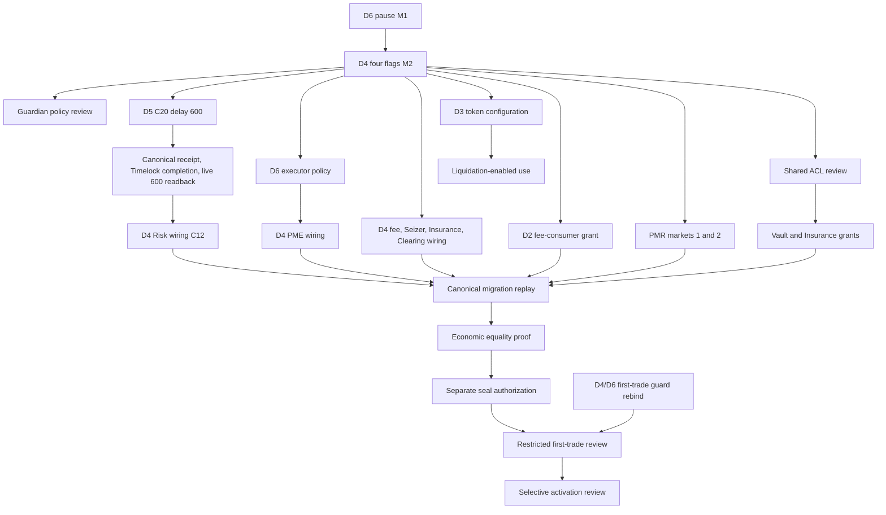

# Base Sepolia replacement maintenance and governance preflight V1

**Verdict: PASS for offline planning only.** No Safe proposal, Timelock operation, signature, or public transaction was created. The first separate future milestone is `PERPS_V2_BASE_SEPOLIA_D6_INITIAL_PAUSE_PREPARATION_V1`; it must still review and authorize each public governance step.

At Base Sepolia block **48,000,221** (`0x63a2011c4682e9786f3e49ca06b37b67bc9934d3e48fe126039793fdbb8249d5`), all six replacement addresses had their expected runtime hashes and ProtocolTimelock ownership. The D6 deployment receipt `0x99b5f01a24ec1038e6d75177b006de25fe157419412cf461c21ba1efdd4d91ac` succeeded and names the canonical D6 address. The full pinned readback is in `post_deployment_maintenance_preflight_v1.json`.

| Stage | Address | Runtime Keccak-256 |
| --- | --- | --- |
| D1 PMR | `0x6B3D846536116082dC4E7227861C341Bb85Ee963` | `0x7aca46efbadcc4b8770e5f399deb54a381eb3f32bff45126a8a9564ad34c24c5` |
| D2 FMV2 | `0x9947F42cC29A32992bbf2030ee49E35C839EDEd5` | `0x732101d67fb112f6d3159f32852071bbf995f8bd1995335cf9a2b0f167d08726` |
| D3 Seizer | `0x43Ac3782e75018981a8F8d210049f2A185b07331` | `0x6d199e027af598ee903513a1ab41e27e2937115c79b8ec85e386d739615befcb` |
| D4 Engine | `0xd0901DE8f6de72aecC716CA1465C4Cf58a0B99fB` | `0x1ee5dc2756bea85a4ab327ff69f8652ef6aa0acf2883f00ad1a23c7f51f95785` |
| D5 Risk | `0x90CAA6D5bC628577bc76d6Cc8b775f983c75e110` | `0x8c782209845865d35ecff80c00525ef3f0f335bea4e7b9846f01199c60fb5a2c` |
| D6 PME | `0xeeA4e5d891B90D3d99E9C4e2c61069911477110E` | `0x3bad813e8654fddf86fb459a738d912b0c6c4dd4ad20119c52a4cc0dc1db834f` |

## Governance and current isolation

OPS Safe `0xA6B9Bb5c7B26B33cfD28C6F5A79B3c527fDdcD46` reports version 1.4.1, three owners, threshold 2, nonce 19, and no enabled modules. ProtocolTimelock `0xa67f8E8E673ce4bb2Fb563B0e6E9FA8F70E3b588` has the Safe as owner, guardian, proposer and executor. Queueing is unpaused and `minDelay` is **86,400 seconds**. Its source requires the proposer role to queue, the executor role to execute, `eta >= schedule timestamp + minDelay`, and execution within the 14-day grace period. Safe review and two owner signatures must precede each Safe execution; queued status alone is not execution. The Safe is also the current Timelock cancellation authority as owner/guardian. Live Safe nonce and roles must be refreshed for each later step.

D4 is OPEN (`migrationState=0`) with zero snapshot, Risk and PME pointers, no seeded positions for the six canonical migration traders, zero residual debt, no configured PMR markets, and no Vault or Insurance authorization. D5 points to D4 but `maxOracleDelay=0`; C20 has not executed and C12 is not authorized. D6 points to D4, starts `paused=false`, and has only the Timelock among the two tested executor candidates (`isExecutor(Timelock)=true`, `isExecutor(runtime executor)=false`). D4 has all four emergency flags false. These constructor defaults are **not** operational readiness. The backend was observed stopped locally. D4's `marketState(1/2)` views revert while PMR markets are absent, so direct market OI readback is unavailable at this block; the zero canonical positions, empty PMR, zero pointers and migration/debt readbacks bound the empty-state claim.

The Vault clearing ledger remains **1,000,000,000 raw mUSDC** and the Vault's mUSDC balance is **224,066,000,000 raw units**. D4 remains unauthorized in Vault and Insurance. D3's mUSDC seize configuration is `(spreadBps=0, isEnabled=false, isSet=false)`. Replacement D2 has a zero Merkle root and no D4 fee-consumer permission; sampled rebate budgets are zero. Legacy liabilities have not been imported into D2. These are bounded checks, not a claim that every possible account was enumerated.

Historical PME V1 and PME V2 remain paused. V1, OLD_ENGINE and stranded NEW_ENGINE each retain all four emergency flags true; OLD and stranded engines remain sealed with the historical snapshot hash. Historical Vault/Insurance grants still exist for some of those engines, so future shared Risk or ACL changes must not be described as isolating every historical path automatically.

## Exact maintenance controls and order

`M1_D6_PAUSE` is the first operation: D6 `pause()` with calldata **`0x8456cb59`**, value zero. Frozen `PerpMatchingEngineV2` allows guardian or owner to pause, emits `Paused(address)`, and allows only the owner to unpause. D6's guardian is zero, so the current authorized target caller is the Timelock owner. The setter only changes `paused`; it does not rebind Engine, alter executors, trader nonces or fills, or touch shared custody.

After a canonical M1 execution receipt and fresh `D6.paused()==true` readback, `M2_D4_FOUR_FLAG_CLOSE` may be separately reviewed. Its single target call is `setEmergencyModes(bool,bool,bool,bool)` with four `true` arguments, selector **`0xf64e345d`**, value zero; exact 132-byte calldata is in `maintenance_operation_plan_v1.json`. The D4 owner or guardian may tighten flags, but a guardian distinct from owner cannot relax any active flag. Current D4 owner and guardian are both the Timelock. The call emits four per-flag events when values change and always emits `EmergencyModeUpdated`. A separate V2 global-pause setter/getter does not exist: the inherited legacy `_paused` is initialized false, while V2 uses the granular flags. No additional global-pause operation is proposed.

M1 comes first because it closes the matching entrypoint before altering Engine controls and leaves a safe stopping state if M2 is delayed. Both target operations require independent Safe schedule and execute transactions and independent postflights. They must not be batched. The Timelock operation identity is `keccak256(abi.encode(target, value, calldata, eta))`; `eta` and therefore the operation hashes remain unset. No salt, Safe nonce binding, gas envelope, Safe proposal or signed payload was invented. A repeated target pause is a no-op in Solidity, but repeating an already consumed Timelock operation ID fails; any *new* duplicate schedule should be blocked by a fresh target readback.

An isolated fork at block 48,000,221 exercised the live Timelock contract with its real Safe proposer/executor role and 86,400-second delay. It scheduled M1, rejected early execution, executed M1 after local time advance, checked the M1 stopping point, then separately scheduled/executed M2 and read all four flags. Targeted negatives covered unauthorized runtime executor/deployer/lost owner, bad target and calldata, duplicate operation ID, and guardian relaxation. No shared Vault ledger/token balance, ACL, D4 Risk/PME pointer, migration state or D1 code changed in the rehearsal. The fork impersonated the Safe address to exercise Timelock permissions; it did **not** generate or verify real 2-of-3 Safe signatures. There was no public mutation.

## Remaining dependency graph

Guardian handoffs, executor grant and Timelock bootstrap revocation, market/token configuration, fees routing, wiring, shared grants and migration each need their own reviewed operations. Keep D6 paused while reviewing the runtime executor identity; do not revoke the Timelock bootstrap executor before the replacement policy and final bounded inventory are reviewed. D4 four flags and D6 pause must be read back before shared economic permissions. Dual-engine Vault/Insurance authorization and later stranded grants revocation need separate risk review; a new grant cannot silently replace an old one. C20's canonical execution and fresh D5 600-second readback are mandatory before C12 scheduling, authorization or execution, under the corrected manifest (`745e7a2fad6a77fef6e35f10a1a431b75615524f51fe13c881c191351ad591fe`) and supported C12 workflow. D3 token configuration must precede liquidation-enabled use. The clearing ledger must never be funded again for migration. Full replay and equality precede seal. The restricted first-trade guard still requires D4/D6 address, domain, nonce, executor and policy rebinding; no live sender is armed. No generic unpause-all is permitted.

## First future operation review template and stopping rules

The next milestone should prepare **M1 only**. It must refresh chain ID, D1–D6 code and relevant state, Safe owners/threshold/nonce/modules, Timelock owner/guardian/proposer/executor/minDelay/queuePaused, backend status, exact M1 target/calldata and a separately chosen ETA. It must calculate and review the exact Timelock operation hash only after ETA is fixed. It must separately review the Safe scheduling transaction, wait for the live delay, then separately review execution. A canonical successful receipt, exact Timelock event and fresh D6 pause readback are required before M1 is complete. If scheduling/execution fails or submission is ambiguous, stop, reconcile read-only, and block M2. After M1, leaving D6 paused and D4 OPEN/unwired is a safe stopping point. After M2, leaving D6 paused and all D4 flags true is another safe stopping point; neither state authorizes any wiring or shared grant.

Validation: six focused Foundry fork tests passed, zero failed/skipped; 31 focused C12/C20 Python tests passed, zero failed/skipped. The fork exercised Timelock role and delay checks but not actual Safe signature collection, a public transaction sender, or live postflight. The repository's off-chain C12 workflow cannot prevent an authorized Safe from constructing a separate generic transaction; independent governance review remains mandatory at every boundary.
