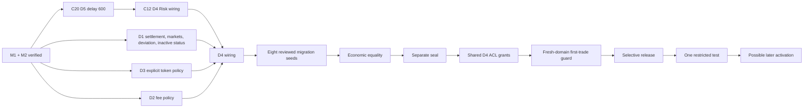

# Base Sepolia governance sequence after initial maintenance closure

The machine-readable dependency graph is `artifacts/perps_v2_replacement_deployment/post_maintenance_dependency_dag_v1.json`. It contains 57 stages and 83 hard edges, including review-only gates and individually governed operations. It fixes no future ETA, operation ID or Safe nonce. D4's four emergency flags and D6 pause stay in force throughout protected configuration and migration.

Parallel **preparation** is possible for C20, market parameters, D3 token policy, fees, guardian capability, runtime executor identity and shared ACL policy. Public execution of dependent operations must obey the DAG. In particular, C20 must execute and D5 must read back 600 before C12 can be queued; a planned or queued C20 is insufficient. D1 market creation immediately sets `isActive=true`, so each creation is followed by its own inactive-status operation under D4/D6 maintenance. D1 pause/config pause then prevents further registry setters until a separately authorized owner release. Migration cannot be resequenced past equality and seal. The runtime PME executor must be granted and verified before bootstrap removal. The historical Engine and Risk dependencies remain relevant to shared cutover; do not assume they become isolated merely by wiring D4.

For every future Timelock-governed action: verify fresh Base Sepolia chain, runtime, owner, maintenance and prerequisites; prepare exactly one target/value/calldata/ETA; independently review the custom operation ID; authorize Safe 2/3 scheduling; verify the canonical Safe and `TransactionQueued` receipt; wait at least the live minDelay; independently review and authorize execution; verify Safe `ExecutionSuccess`, `TransactionExecuted`, queue consumption and contract readback. Scheduling never authorizes execution. Each action has a safe stop after its postflight. Ambiguous submissions require read-only Safe nonce, public receipt and Timelock event reconciliation, with no automatic retry, replacement or batch continuation.

The following stopping boundaries are hard. The future D6 unpause is **not** a safe idle state: it creates a monitored restricted-active window and requires a separately reviewed emergency re-pause contingency before authorization. No operation in this roadmap releases maintenance now.

| Boundary | Required proof before proceeding | Safe stopping state |
| --- | --- | --- |
| C20 → C12 | Canonical C20 execution receipt, event and fresh D5 `maxOracleDelay=600` | D4 closed, D6 paused, Risk pointer zero |
| Market creation → economic access | Exact market IDs/parameters and separate inactive-status readbacks | D4 closed, D6 paused, markets inactive |
| Wiring → migration | Oracle/risk, D3 tokens, fees, D4 reciprocal pointers and ACL policy reviewed | D4 OPEN, closed and economically inert |
| Each seed → next seed | Canonical receipt and exact per-entity readback; no Vault/Clearing funding | D4 OPEN; partial replay recorded, no auto-continuation |
| Replay → seal | Six positions, funding/OI/debt and shared ledger equality against snapshot | D4 OPEN and closed until independent seal approval |
| Seal → D4 shared grants | Canonical SEALED readback, dual-engine policy and no-double-funding check | D4 closed, D6 paused; grants absent until reviewed |
| Guard → selective release | Fresh D4/D6 identity, domain, executor inventory, signatures and exact one-shot limits | D4 closed, D6 paused |
| Restricted test → later activation | One exact trade receipt and accounting/guard acceptance | No automatic public launch |

The first next milestone is **PERPS_V2_BASE_SEPOLIA_C20_ORACLE_DELAY_PREPARATION_V1**. It is preparation-only. No action in this sequence is currently scheduled or authorized by this document.
